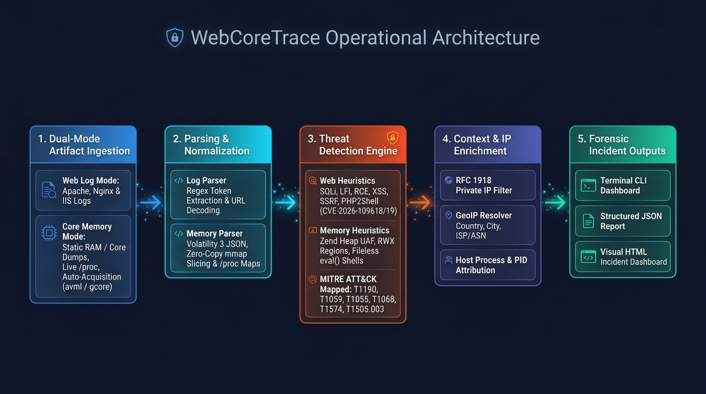

# Automated Web Server Access Log Threat Hunter (`Web Core Trace`)

A lightweight Python forensic command-line tool that parses standard web server access logs (Apache, Nginx, or IIS Common/Combined Log Format) and performs host/runtime memory forensics. This tool is designed to apply high-fidelity regular expressions to detect common attack vectors mapped to **MITRE ATT&CK®**, enriches IP addresses, perform memory analysis (static, live, or automated acquisition) and outputs structured **JSON** and interactive **HTML** forensic reports.

---

## Why `Web Core Trace`?
Modern web server breaches rarely leave their full footprint in a single place—initial exploitation triggers appear at the **network boundary** in web access logs, while advanced post-exploitation payloads hide in **volatile host memory**. However, incident responders and sysadmins typically face a dilemma:
- **Heavy Enterprise SIEMs & EDRs** (Splunk, Datadog, CrowdStrike) are costly, complex to deploy, and require shipping sensitive logs or memory telemetry off-premise.
- **Siloed CLI Utilities** (`grep`/`awk` for logs, or manual debugger/hex inspection for core dumps) are slow, miss multi-request behavioral sequences (such as worker crashes followed by state reuse), and cannot correlate web-layer exploits with in-memory implants.

**`Web Core Trace` bridges this gap.** It is a standalone, lightweight, dual-mode forensic hunter that correlates pre-exploit web access log anomalies with post-exploitation runtime memory artifacts (UAF heaps, `rwx` regions, hooked pointers, fileless web shells, and rogue worker shells) in seconds.

---

## Core Goals & Design Philosophy

1. **Zero External Dependencies:** Built using Python's standard library (with optional `rich` formatting), ensuring it runs out-of-the-box on air-gapped forensic workstations or minimal production servers.
2. **Dual-Mode Forensic Architecture (`web-log-triage` & `core`):**
   - **`web-log-triage` Mode (Application & Network Boundary):** Streams flat text access logs (Apache, Nginx, IIS Common/Combined) line-by-line to detect external exploit triggers, scanners, and **PHP2Shell (`CVE-2026-109618` / `CVE-2026-109619`)** state manipulation.
   - **`core` Mode (Host & Runtime Boundary):** Inspects static RAM/core dumps (`--memory-dump` via Volatility 3 JSON or zero-copy binary `mmap`), live `/proc` process trees (`--live-host`), or automated acquisitions (`--acquire-and-scan` via `avml`/`gcore`) for post-exploitation memory artifacts.
3. **Dual-Pass Web & Memory Heuristics:**
   - **Web Layer:** Evaluates individual requests against regex signatures (SQLi, LFI, RCE, XSS, SSRF, PHP2Shell OOM triggers) and correlates multi-request sequences (directory brute-forcing and `500`/`502`/`503` $\rightarrow$ `200` worker state reuse).
   - **Memory Layer:** Detects Zend heap Use-After-Free (UAF) dangling pointers, cross-worker orphan heap chunks, `rwx` executable heaps, hooked/corrupted function pointers, fileless opcache `eval()` web shells, and web workers spawning shell interpreters.
4. **Anti-Evasion & URL Normalization:** Automatically unquotes URL encodings (`%20` $\rightarrow$ space, `%27` $\rightarrow$ `'`, `%2f` $\rightarrow$ `/`) while preserving raw URI inspection for `%XX` OOM floods.
5. **MITRE ATT&CK® Alignment:** Every web and memory alert is pre-mapped to official ATT&CK Enterprise techniques (`T1190`, `T1059`, `T1055`, `T1068`, `T1574`, `T1505.003`, `T1595`).
6. **Multi-Format Reporting:** Instant terminal dashboard for quick scoping, structured JSON for SIEM ingestion, and self-contained HTML reports for executive reporting.

---

## Architecture & Operational Pipeline


---

## Quickstart & Installation

Choose your preferred setup method:

### Linux & macOS (Using `make`)

If you are on Linux or macOS, you can use the automated `Makefile`:

```bash
# 1. Setup virtual environment and install in editable mode
make install

# 2. Run the test suite
make test

# 3. Run triage on sample logs
make run

# 4. Run core mode on sample memory
make run-core

# 5. Generate visual HTML report
make html

# 6. Generate JSON report for tool ingestion
make json

# 7. Remove virtualenv, caches, and report file
make clean
```

### Windows (PowerShell/Python)

If you are on Windows, you can use the automated `wlt-setup.ps1`

```powershell
# 1. Setup virtual environment and install dependencies
.\wlt-setup.ps1 install

# 2. Run the test suite
.\wlt-setup.ps1 test

# 3. Run triage on sample logs
.\wlt-setup.ps1 run

# 4. Run core mode on sample memory
.\wlt-setup.ps1 run-core

# 5. Generate visual HTML report
.\wlt-setup.ps1 html

# 6. Generate JSON report
.\wlt-setup.ps1 json

# 7. Remove virtualenv, caches, and report file
.\wlt-setup.ps1 clean
```

---

## Sample Terminal Output (web-log-triage mode)

```text
=================================================================
 Web Core Trace - FORENSIC SUMMARY
=================================================================
 Total Requests Analyzed : 8
 Unique IP Addresses     : 5
 Total Threats Detected  : 12
=================================================================

[+] Top Offending IPs & Network Geolocation:
  203.0.113.99     :  5 alerts | Location: Internal/Private (Local Network)
  198.51.100.12    :  4 alerts | Location: Internal/Private (Local Network)
  203.0.113.45     :  2 alerts | Location: Internal/Private (Local Network)
  192.0.2.88       :  1 alerts | Location: Internal/Private (Local Network)

[+] Threat Categories Breakdown:
  • Scanner                : 4
  • Sensitive File Access  : 3
  • LFI                    : 2
  • SQLi                   : 1
  • RCE                    : 1
  • Brute Force            : 1

[+] Detailed Threat Findings:
  [ 1] [High    ] SQLi         (MITRE T1190) from 203.0.113.45
       Payload : UNION SELECT
       URI     : /products.php?id=1 UNION SELECT null,username,password FROM users
  [ 2] [Critical] RCE          (MITRE T1059.004) from 192.0.2.88
       Payload : whoami
       URI     : /cgi-bin/test.sh?cmd=whoami;id
  [ 3] [High    ] Brute Force  (MITRE T1595.003) from 203.0.113.99
       Payload : Potential directory brute-force: 3 failed requests
       URI     : /.env
=================================================================
```

---

## CLI Usage & Options
```bash
usage: Web Core Trace [-h] [--mode {web-log-triage,core}] [-f {console,html,json}]
                      [-o OUTPUT] [--threshold THRESHOLD] [--no-geoip]
                      [--memory-dump MEMORY_DUMP] [--live-host]
                      [--acquire-and-scan {avml,gcore}] [--pid PID]
                      [log_file]

WebCoreTrace: Dual-Mode Web Access Log & Host Memory Forensic Triage Tool

positional arguments:
  log_file              Path to the access log file (for web-log-triage mode; Combined/Common format)

options:
  -h, --help            Show this help message and exit
  --mode {web-log-triage,core}
                        Execution mode: 'web-log-triage' (access logs) or 'core' (RAM/process memory)
  -f, --format {console,html,json}
                        Report format: console, html, or json (default: console)
  -o, --output OUTPUT   Output file path for html/json
  --threshold THRESHOLD
                        Brute-force 404/403 threshold (default: 3)
  --no-geoip            Disable online GeoIP lookups (offline mode)
  --memory-dump MEMORY_DUMP
                        Path to static RAM/core dump or Volatility 3 JSON snapshot
  --live-host           Inspect live host processes via /proc
  --acquire-and-scan {avml,gcore}
                        Acquire memory with avml/gcore and scan immediately
  --pid PID             Target process ID for --live-host or --acquire-and-scan
```

---

## Threat Detection & MITRE ATT&CK® Mapping

| Threat Category | Mode / Source | MITRE Technique | MITRE Tactic | Description |
| -------- | -------- | -------- | -------- | -------- |
| SQL Injection (SQLi) | `web-log-triage` (`decoded_uri`) | T1190 | Initial Access | `UNION SELECT`, `OR 1=1`, database function injection |
| Local File Inclusion (LFI) | `web-log-triage` (`decoded_uri`) | T1190 | Initial Access | Path traversal (`../`, `..\`) and `/etc/passwd` probing |
| Remote Code Execution (RCE) | `web-log-triage` (`decoded_uri`) | T1059.004 | Execution | Command injection (`whoami;id`, `system`, `eval`) |
| Malicious Scanners | `web-log-triage` (`user_agent`) | T1595.002 | Reconnaissance | Known offensive tools (`sqlmap`, `gobuster`, `nikto`, `nmap`) |
| Directory Brute-Force | `web-log-triage` (`multi-entry`) | T1595.003 | Reconnaissance | High-frequency `401`/`403`/`404` bursts from a single IP |
| Sensitive File Probing | `web-log-triage` (`decoded_uri`) | T1552.001 | Credential Access | Attempts to access `/.env`, `/.git`, `wp-config.php` |
| Cross-Site Scripting (XSS) | `web-log-triage` (`decoded_uri`) | T1059.007 | Execution | `<script>` injection, DOM event handlers, `javascript:` |
| Cloud Metadata / SSRF | `web-log-triage` (`decoded_uri`) | T1552.005 | Credential Access | Probing AWS/Azure/GCP instance metadata (`169.254.169.254`) |
| PHP2Shell (`CVE-2026-109618`) | `web-log-triage` (`raw_uri`) | T1190 | Initial Access | Oversized URL-encoded keys/queries & deep array nesting OOM triggers |
| PHP2Shell (`CVE-2026-109619`) | `web-log-triage` (`decoded_uri` / `multi-entry`) | T1190 | Initial Access | Multipart anomalies & persistent worker fault (`500`/`502`/`503` $\rightarrow$ `200`) state reuse |
| Memory UAF / Dangling Pointer | `core` (`heap_chunks`) | T1068 | Privilege Escalation | Freed Zend heap chunks retaining active non-null target pointers |
| Orphan Zend Heap Structure | `core` (`heap_chunks`) | T1055 | Defense Evasion | Zend heap chunks crossing worker PID boundaries |
| Executable Heap (`RWX`) | `core` (`regions`) | T1055 | Defense Evasion | Anomalous `rwx` memory regions in web server worker spaces |
| Function Pointer Hook / Corruption | `core` (`function_pointers`) | T1574 | Persistence | Core Zend/module function pointers pointing outside valid module bounds |
| Fileless Web Shell | `core` (`opcache_scripts`) | T1505.003 | Persistence | Memory-resident PHP execution streams (`eval()'d code`) with no file on disk |
| Suspicious Worker Child Process | `core` (`processes`) | T1059 | Execution | Web workers (`php-fpm`, `httpd`, `nginx`) spawning shell interpreters (`sh`, `bash`, `cmd.exe`) |

---

## Troubleshooting, Common Issues, & Tips

### Linux / macOS

- **Check Virtual Environment Execution Permissions:**
  If you see a `Permission denied` error when running `make` commands:
  Ensure the generated binaries in `.venv` have execute permissions:
  ```bash
  chmod +x .venv/bin/*
  ```
- **Avoid Using 'sudo':**
  Never run *sudo make* or *sudo pip*. If *.venv* was accidentally created with *sudo*, fix file ownership to your current user:
  ```bash
  sudo chown -R $USER:$USER .
  ```
  Or remove and rebuild the environment cleanly:
  ```bash
  make clean
  make install
  ```
- **Filesystem Mount Flags (noexec):**
  If your project directory is located on an external drive or a network share mounted with the **noexec** flag, Linux/macOS will block binaries from running inside *.venv*. Move the project to your local home directory (e.g. *~/workspace/*).

### Windows

- **PowerShell Script Execution Disabled on Windows:**
  If PowerShell prevents script execution, run:
  ```powershell
  Set-ExecutionPolicy -ExecutionPolicy RemoteSigned -Scope CurrentUser
  ```

---

## Release Notes & Version History

### `v1.0.0` — Dual-Mode Architecture & Host Memory Forensics (`WebCoreTrace`)
- **Project Rebrand & Package Refactor:** Evolved `web-log-triage` into `WebCoreTrace` (`web_core_trace`).
- **Dual-Mode Architecture (`--mode web-log-triage` | `--mode core`):** Seamlessly correlates pre-exploit network boundary triggers with post-exploitation runtime memory artifacts.
- **PHP2Shell Detection (`CVE-2026-109618` & `CVE-2026-109619`):** Added signature and behavioral heuristics for oversized URL-encoded OOM triggers, multipart anomalies, and persistent worker fault (`500`/`502`/`503` -> `200`) state reuse.
- **Memory Ingestion Engine (`memory_parser.py`):** Added static JSON/binary `mmap` core dump parsing (`--memory-dump`), live `/proc` host inspection (`--live-host`), and automated `avml`/`gcore` memory acquisition (`--acquire-and-scan`).
- **Memory-Layer Threat Heuristics:** Detects Zend heap UAF dangling pointers, cross-worker orphan heap structures, `rwx` executable heaps, corrupted function pointers, fileless opcache `eval()` web shells, and web workers spawning shell interpreters.

### `v0.1.0` — Initial Release (October 2026)
- **Core Parser:** Streaming ingestion of Combined and Common Log Format (CLF) access logs with URL decoding.
- **Threat Detection Engine:**
  - Signature detection for SQLi, LFI, RCE, XSS, Cloud Metadata (SSRF), and malicious scanner User-Agents.
  - Multi-request behavioral anomaly detection for directory brute-force attacks (`404`/`403` frequency spikes).
  - Full alignment with **MITRE ATT&CK® Enterprise** techniques.
- **IP Intelligence:** In-memory cached IP enrichment distinguishing RFC 1918 private/bogon networks from public targets with GeoIP lookup.
- **Reporting Engine:**
  - Dynamic terminal dashboard summary with status code and threat distributions.
  - Machine-readable structured JSON export.
  - Self-contained, responsive HTML forensic report with modern dark theme and threat badges.
- **Cross-Platform Tooling:** Automated setup via `Makefile` (Linux/macOS) and `wlt-setup.ps1` (Windows PowerShell), plus `pyproject.toml` support.

---

### Future Roadmap
- [ ] Offline MaxMind GeoLite2 `.mmdb` database support
- [ ] Custom user rule loading from external YAML/JSON files
- [ ] Webhook alerting (Slack, Discord, Microsoft Teams)
- [ ] Support for JSON-formatted web server logs

---

## Author & Maintainer

- **Developer:** Gavin Kye / Cybersecurity Consultant
- **Role:** Digital Forensic/IR/Malware Investigator - Security/Software Engineer
- **GitHub:** [@gkye-cyber](https://github.com/gkye-cyber)
- **LinkedIn:** [linkedin.com/in/gavin-kyesr](https://linkedin.com/in/gavin-kyesr)
- **License:** Distributed under the MIT License. See [`LICENSE`](LICENSE) for details.